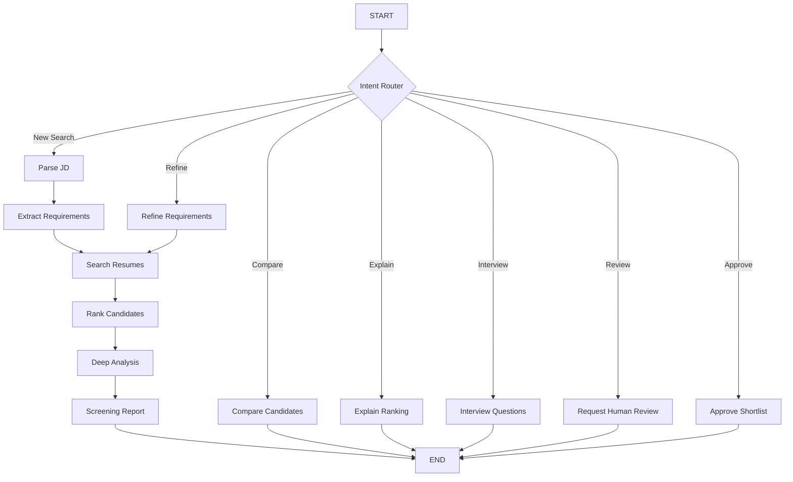

# Agentic Profile Matching — Architecture

## Main Components

### Streamlit
Provides the recruiter interface, chat, shortlist table, screening dashboard, and report download.

### LangGraph
Coordinates the workflow and maintains conversation state.

### Groq
Handles structured requirement extraction, intent detection, and interview question generation.

### ChromaDB
Stores vector embeddings and retrieves semantically relevant resume content.

### Advanced Ranker
Calculates weighted matching scores using skills, experience, and semantic similarity.

### Deep Analyzer
Produces preliminary screening assessments for the top 10 candidates.

### Recommendation Service
Generates Markdown screening reports.

## LangGraph Workflow



## Screening Rounds

Round 1: Resume retrieval and preliminary ranking.

Round 2: Deep analysis of the top 10 candidates.

Round 3: Recommendation report generation and human review.

## State Management

LangGraph state stores:

- Job description and requirements
- User intent
- Retrieved candidates
- Ranked shortlist
- Deep candidate analyses
- Screening report
- Human feedback
- Approval status
- Screening round

## Human Oversight

The application allows reviewers to request additional review, refine requirements, and approve candidates for interviews.

It does not automatically verify qualifications or make final hiring decisions.
```
